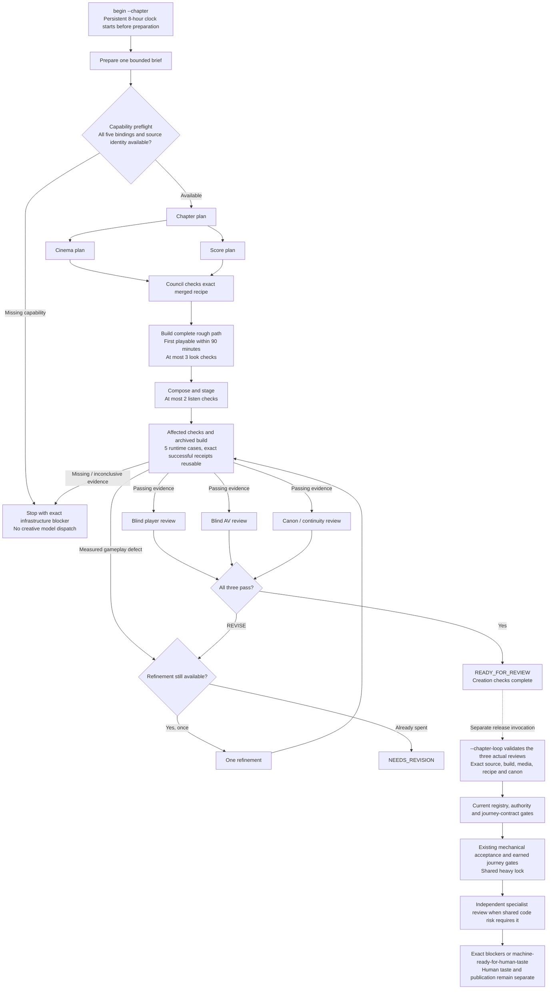

# Chapter testing and review workflow

Map of the implemented `throughput-v2` path. This describes the workflow, not a
completed chapter run or a measured speedup. Existing frozen checkpoints retain
their original instructions, clock and spent allowances.

Cinema and score planning run concurrently after the chapter plan. The player,
AV and canon reviews run concurrently after evidence is sealed; each keeps its
own fresh provider session, commission and input restrictions. Source-writing
roles run sequentially. GPU captures and the player probe retain the same
machine lock used by Paraform. Parallel dispatch shares the existing usage
ceilings and cannot create more role, review or refinement allowances.

The eight-hour clock also caps machine release commands and includes preparation, waits, interruptions and
recovery. Restarting the process or changing the output directory does not reset
it. Reported context is capped at 32,000 tokens, the complete input packet at
48,000 bytes, and each transcript at 16,000,000 bytes. The full numeric contract
and commands are in [chapter-loop.md](chapter-loop.md).

## Five runtime cases

| Case | Required evidence |
| --- | --- |
| Manual play | Ordinary controls produce an accepted action |
| Pause/Resume | Real interruption, recovery and a subsequent accepted action |
| Continue | Real Continue click, saved-state equality and a newly accepted action |
| AV | Video and audible audio decode, with nonblank frames |
| Continuity | Observed earned entry and exit without fixture shortcuts |

Every case requires hardware GPU identity, exact candidate identity and proof of
owned browser/audio cleanup. Capability preflight checks transport availability;
it cannot prove these runtime outcomes. A timed-out fresh journey stays
inconclusive. A direct-entry diagnostic does not become an earned chapter pass.

## Reuse and invalidation

| Receipt | Bound inputs | What forces new work |
| --- | --- | --- |
| Static check / build | Game source, exact command, declared/transitive helpers, relevant lockfiles and validation tools | Changed inputs or output artifacts; unsafe dependency graph; prior non-success |
| Runtime case | Above, plus exact build, assertions, report/raw data and media bytes | Any changed dependency or evidence; failed/inconclusive case |
| Independent review | Candidate, recipe, canon, media, scope, original provider session and result | Changed reviewed material, missing provenance or a non-PASS result |

Game source includes runtime assets, configuration, generators and runtime/build
dependencies. Chapter Loop and unrelated probe/test changes do not themselves
make a new game candidate. Affected probe changes still invalidate their own
receipts. Explicit `dependencies` must include subprocess helpers; unresolved
or dynamic dependency graphs conservatively rerun. Original reports remain
unchanged and bundles identify reused artifacts as reused.

## Release coverage

`chapter:accept:workflow --chapter-loop <run-directory>` validates the three
actual independent creation reviews instead of adding another general panel.
Every review category must still score at least 4/5, with no major or blocking
finding. The command retains current registry/authority/journey-contract gates
and existing mechanical and earned journey runtime checks. Exact successful
command receipts may be reused; missing or stale evidence blocks certification.

Shared engine, persistence, audio-engine and rendering changes require an
independent specialist review of the affected code. Chapter content alone does
not require that extra review. The output is a release evidence report and exact
blockers, or `machine-ready-for-human-taste`; it does not publish or claim human
taste acceptance. Archived legacy release runs keep their original workflow.

Synthetic adapter tests establish transport behavior. They do not establish
chapter quality, a fresh production capture, or a production speedup.

## Sources

- [Chapter Loop contract](../main/tools/chapter-loop/contract.mjs)
- [Persistent chapter clock](../main/tools/chapter-loop/budget.mjs)
- [Checked runner and parallel dispatch](../main/tools/chapter-loop/runner.mjs)
- [Evidence and assertions](../main/tools/chapter-loop/evidence.mjs)
- [Source and evidence cache](../main/tools/chapter-loop/cache.mjs)
- [Runtime capture and capability preflight](../main/tools/chapter-loop/runtime-capture.mjs)
- [Release review and deterministic gates](../main/tools/chapter-loop/release-review.mjs)
- [Creation role commissions](../.claude/agents/chapter-loop/)
- [Repository commands](../main/package.json)
